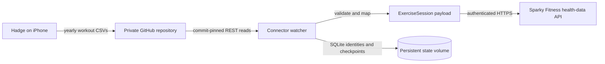

# Architecture

## Overview

## Data flow

1. Resolve the configured GitHub branch to a commit and list `workouts/YYYY.csv` files at that commit.
2. Skip unchanged snapshots. If any source file changed, read all yearly CSVs at the pinned commit and reject malformed rows with sanitized file/line errors.
3. Filter entire diary days before `EXPORT_SINCE`, then compare each HealthKit UUID and normalized fingerprint with persistent state. A cutoff never splits a daily batch.
   Diary dates are computed in `SPARKYFITNESS_TIMEZONE` and sent with that same `record_timezone` plus the actual start instant in `timestamp`. This keeps Sparky's pre-cleanup date range aligned with the complete daily batch, including workouts near midnight.
4. Submit complete daily JSON batches for days with new or changed workouts. Sparky removes source records omitted from a submitted date range, so each batch includes every valid workout for that day plus retained accepted payloads for rows removed from the export. UUIDs are sent as `source_id` for updates and retry deduplication.
5. Save fingerprints and accepted payloads after the whole daily batch is acknowledged. Checkpoint source files only when the snapshot has no parsing or import failures; failures are retried.

`preview` opens SQLite read-only, does not call Sparky, and does not write source checkpoints. The watcher re-reads mounted secrets on each cycle, handles signals, and waits at least the configured interval after operational failures.

## State

| Table | Key | Purpose |
| --- | --- | --- |
| `workouts` | Hadge repository ID + HealthKit UUID | Fingerprint and health-data payload of the last accepted workout, retained for complete daily updates |
| `files` | Repository/date-filter scope + source path | SHA of a fully processed Hadge CSV |

If a process exits after Sparky accepts a workout but before local state commits, the next run may send the workout again. Sparky's `(user, source, source_id)` sync identity handles that recovery window.

Older SQLite states without payloads are migrated on the next mutating sync. File checkpoints are cleared so accepted source records are re-read and their daily payloads rebuilt. Preview remains read-only.

## External interfaces

- GitHub REST API: private repository metadata, selected branch commit, yearly workout file list, and raw CSV contents.
- Sparky Fitness `POST /api/health-data`: authenticated `ExerciseSession` requests with `X-Workout-Model-Version: 3`. Non-2xx responses and per-record `errors`/`skipped` results are treated as failures.
- No inbound port, Sparky database credentials, filesystem mounts into Sparky, or Sparky source modifications are required.
