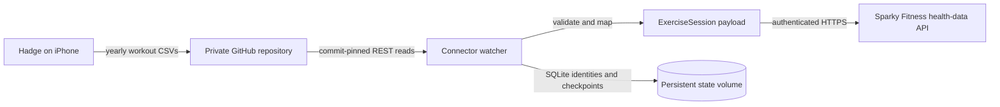

# Architecture

## Overview

The watcher connects one immutable source snapshot to Sparky's daily replacement API. Persistent accepted payloads preserve the rest of a day when one workout changes.



## Components

### Configuration and CLI

`config.py` validates environment values and reads credentials. `cli.py` selects `check`, `preview`, `sync`, or `watch`, emits summaries, handles signals, and manages the polling loop. Both clients are rebuilt each cycle so mounted secret files can rotate.

### GitHub reader

`github.py` resolves the branch to a commit, discovers yearly files, and fetches their bytes at that commit. Repository ID and blob SHAs supply stable identity and cache checkpoints. A changed source file causes the coordinator to re-read the complete current snapshot.

### Workout parser and mapper

`workout.py` validates CSV rows into immutable `Workout` objects. It computes fingerprints, converts meters to kilometers, retains source timestamps, and derives the target diary day in the explicit IANA timezone. See [Workout data](./data.md) for field limits and mappings.

### Sync coordinator and state

`sync.py` filters whole diary days, finds pending UUIDs, and merges current rows with accepted payloads before submitting daily batches. `state.py` stores fingerprints and payloads in SQLite and checkpoints successful files. A nonblocking file lock prevents overlapping mutating cycles using the same state directory.

### Sparky client

`sparky.py` sends authenticated JSON batches with bounded retries. It rejects partial record failures and incomplete acknowledgment counts even when the HTTP status is 200. It neither writes the destination database directly nor exposes an inbound endpoint.

## Data flow

1. Resolve the configured GitHub branch to a commit and list `workouts/YYYY.csv` files at that commit.
2. Skip unchanged snapshots. If any source file changed, read all yearly CSVs at the pinned commit and reject malformed rows with sanitized file/line errors.
3. Filter entire diary days before `EXPORT_SINCE`, then compare each HealthKit UUID and normalized fingerprint with persistent state. A cutoff never splits a daily batch.
   Diary dates are computed in `SPARKYFITNESS_TIMEZONE` and sent with that same `record_timezone` plus the actual start instant in `timestamp`. This keeps Sparky's pre-cleanup date range aligned with the complete daily batch, including workouts near midnight.
4. Submit complete daily JSON batches for days with new or changed workouts. Sparky removes source records omitted from a submitted date range, so each batch includes every valid workout for that day plus retained accepted payloads for rows removed from the export. UUIDs are sent as `source_id` for updates and retry deduplication.
5. Save fingerprints and accepted payloads after the whole daily batch is acknowledged. Checkpoint source files only when the snapshot has no parsing or import failures; failures are retried.

`preview` opens SQLite read-only, does not call Sparky, and does not write source checkpoints. The watcher re-reads mounted secrets on each cycle, handles signals, and waits at least the configured interval after operational failures.

## State

| Table | Key | Purpose |
| --- | --- | --- |
| `workouts` | Hadge repository ID + HealthKit UUID | Fingerprint and health-data payload of the last accepted workout, retained for complete daily updates |
| `files` | Repository/date-filter scope + source path | SHA of a fully processed Hadge CSV |

The `workouts` columns are `repo`, `uuid`, `fingerprint`, and serialized JSON `payload`. The `files` columns are `scope`, `path`, and `sha`. Destination URL/account ID is not stored; keep a volume assigned to one destination as described in [Recovery](./recovery.md).

If a process exits after Sparky accepts a workout but before local state commits, the next run may send the workout again. Sparky's `(user, source, source_id)` sync identity handles that recovery window.

Older SQLite states without payloads are migrated on the next mutating sync. File checkpoints are cleared so accepted source records are re-read and their daily payloads rebuilt. Preview remains read-only.

## External interfaces

- GitHub REST API: private repository metadata, selected branch commit, yearly workout file list, and raw CSV contents.
- Sparky Fitness `POST /api/health-data`: authenticated `ExerciseSession` requests with `X-Workout-Model-Version: 3`. Non-2xx responses and per-record `errors`/`skipped` results are treated as failures.
- No inbound port, Sparky database credentials, filesystem mounts into Sparky, or Sparky source modifications are required.

## Directory layout

```text
src/hadge_sparkyfitness_connector/
  cli.py        Commands, summaries, watcher lifecycle
  config.py     Environment and secret-file validation
  github.py     Commit-pinned GitHub reads
  workout.py    Hadge parsing, fingerprints, JSON mapping
  sparky.py     Destination HTTP transport and acknowledgments
  state.py      SQLite accepted payloads and checkpoints
  sync.py       Daily batch coordination and lock boundary
tests/e2e/      Real Sparky/PostgreSQL fixture stack and fault proxy
scripts/        Release tooling and shared-docs preview entry points
test_harness.py Docker acceptance-suite orchestration
```

## Design decisions

Complete daily batches are required because Sparky removes omitted source workouts from a submitted date range. Retained payloads protect accepted rows removed from later source exports. Explicit `record_timezone` and `timestamp` fields align the target's date resolution with those batches, including near midnight. These behaviors are verified by [Testing](./testing.md).
